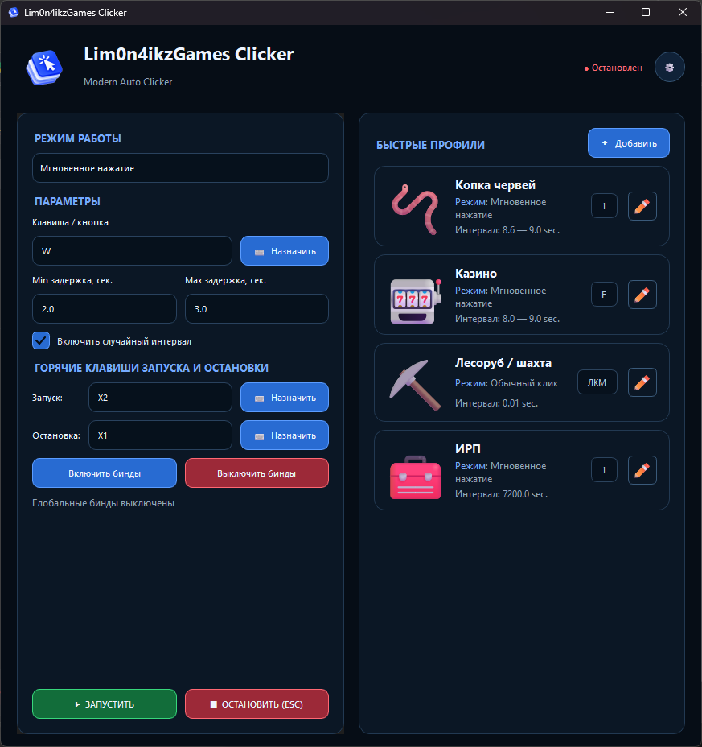

# 🍋 Lim0n4ikzGames Clicker

**Lim0n4ikzGames Clicker** — автоматический кликер для Windows с поддержкой клавиатуры, мыши, последовательностей и комбинаций клавиш.

Программа позволяет автоматизировать повторяющиеся действия с помощью настраиваемых интервалов, горячих клавиш и профилей.

---

## ✨ Возможности

* 🖱️ Автоматическое нажатие кнопок мыши
* ⌨️ Автоматическое нажатие клавиш клавиатуры
* 🔗 Поддержка комбинаций клавиш
* 🔄 Поддержка последовательностей действий
* ⏱️ Настраиваемый интервал между действиями
* 🎲 Случайный интервал между нажатиями
* 🔒 Режим удержания клавиши
* ⚡ Мгновенное нажатие
* 🎮 Горячие клавиши для запуска и остановки
* 💾 Сохранение настроек
* 📋 Сохранение пользовательских профилей
* 🌐 Поддержка русского и английского языков
* 🌙 Тёмный интерфейс
* 🖥️ Работает в фоне после запуска

---


## 🖥️ Скриншот

<p align="center">
  
</p>

---

## 🎮 Режимы работы

Программа поддерживает четыре режима.

### 1. 🔒 Зажатие клавиши

Клавиша удерживается в течение заданного времени.

Можно настроить:

* клавишу;
* время удержания;
* интервал между действиями;
* случайный интервал.

---

### 2. 🔄 Последовательное нажатие

Позволяет записать последовательность клавиш или кнопок мыши.

Например:

```text
1 → 2 → 3 → ЛКМ → SPACE
```

После записи программа будет повторять указанную последовательность.

Для разделения действий используется:

```text
,
```

---

### 3. ⚡ Мгновенное нажатие

Клавиша или кнопка мыши нажимается один раз без удержания.

Например:

```text
SPACE
```

или:

```text
ЛКМ
```

Можно задать минимальный и максимальный интервал между нажатиями.

---

### 4. 🔗 Мгновенная комбинация

Позволяет одновременно нажимать несколько клавиш.

Например:

```text
CTRL + C
```

или:

```text
SHIFT + SPACE
```

Для разделения клавиш комбинации используется:

```text
+
```

---

## ⌨️ Горячие клавиши

По умолчанию используются:

| Действие     | Клавиша |
| ------------ | ------- |
| ▶️ Запуск    | `F6`    |
| ⏹️ Остановка | `F7`    |

Горячие клавиши можно изменить в настройках программы.

Также предусмотрена возможность отключить использование глобальных горячих клавиш.

---

## 🖱️ Поддерживаемые кнопки мыши

Программа поддерживает:

* `ЛКМ` — левая кнопка мыши
* `ПКМ` — правая кнопка мыши
* `СКМ` — средняя кнопка мыши
* `X1`
* `X2`

Также можно использовать клавиши клавиатуры.

---

## ⏱️ Интервалы

Для автоматических действий можно задать:

* минимальный интервал;
* максимальный интервал;
* время удержания;
* задержку между действиями.

### 🎲 Случайный интервал

При включённом случайном интервале программа выбирает задержку между минимальным и максимальным значением.

Например:

```text
Минимум: 0.5 сек
Максимум: 1.0 сек
```

Каждое следующее действие может выполняться через разное время в пределах указанного диапазона.

---

## 📋 Профили

В программе предусмотрена система профилей.

Профиль позволяет сохранить отдельную конфигурацию кликера и быстро переключаться между различными наборами настроек.

В проекте предусмотрены стандартные профили:

| Профиль            | Режим              |    Интервал | Клавиша |
| ------------------ | ------------------ | ----------: | ------- |
| 🪱 Копка червей    | Мгновенное нажатие |   `8.6–9.0` | `1`     |
| 🎰 Казино          | Мгновенное нажатие |   `8.0–9.0` | `F`     |
| ⛏️ Лесоруб / шахта | Мгновенное нажатие | `0.01–0.01` | `ЛКМ`   |
| 🧰 ИРП             | Мгновенное нажатие | `7200–7200` | `2`     |

Пользователь может создавать и изменять собственные профили.

---

## 💾 Сохранение настроек

Настройки приложения и профили сохраняются автоматически.

В установленной версии Windows они находятся в:

```text
%LOCALAPPDATA%\Lim0n4ikzGamesClicker\
```

Основные файлы:

```text
settings.json
profiles.json
```

`settings.json` содержит настройки приложения.

`profiles.json` содержит сохранённые профили.

При закрытии программы настройки и профили автоматически сохраняются.

---

## 🌐 Язык интерфейса

Поддерживаются:

* 🇷🇺 Русский
* 🇬🇧 English

Язык можно изменить непосредственно в настройках приложения.

---

# 📦 Установка

Для обычной установки программы **не требуется Python или ручная установка зависимостей**.

Используйте готовый установщик:

```text
Lim0n4ikzGamesClickerSetup.exe
```

### Установка

1. Запустите:

```text
Lim0n4ikzGamesClickerSetup.exe
```

2. Следуйте инструкциям установщика.
3. Дождитесь окончания установки.
4. Запустите **Lim0n4ikzGames Clicker** через созданный ярлык.

После установки программа готова к работе.

---

## 🔄 Проверка обновлений

При запуске приложение проверяет файл [`versions.json`](https://github.com/lim0n4ikz/Lim0n4ikzGamesClicker/blob/main/versions.json) в основной ветке GitHub. Если доступна более новая версия, приложение покажет изменения всех версий после установленной и предложит открыть страницу загрузки установщика.

Чтобы опубликовать обновление:

1. Увеличьте `APP_VERSION` в `main.py` и `MyAppVersion` в `Lim0n4ikzGamesClicker.iss` для следующего релиза.
2. Установите `latest_version` и ссылку на установщик в `versions.json`.
3. Добавьте в `releases` запись для новой версии с пунктами `changes.ru` и `changes.en`. Не удаляйте записи предыдущих версий: они нужны, чтобы показать полный список изменений пользователям старых версий.
4. Опубликуйте установщик на GitHub Releases по указанной в `download_url` ссылке.

---

## 📋 Импорт и экспорт профилей

Откройте настройки через кнопку-шестерёнку и выберите «Экспортировать профили» или «Импортировать профили». Экспорт сохраняет профили в JSON-файл, которым можно поделиться. При импорте существующие профили сохраняются, а профили с совпадающими названиями пропускаются. Файл импорта должен быть в формате JSON приложения и иметь размер не более 5 МБ.

---

## 🎨 Настройки приложения

В настройках можно выбрать тёмную, бирюзовую, фиолетовую, зелёную, оранжевую, серую, синюю, красную или розовую тему. Там же находятся ручная проверка обновлений, импорт и экспорт профилей, а также назначение клавиши аварийной остановки. Она активна всегда, даже при выключенных обычных биндах. Рекомендуется отдельная клавиша, например Pause/Break или F12, не используемая для запуска или часто в игре. Выбранные тема, язык и клавиша сохраняются после перезапуска. Внизу отображается информация о разработчике и его Discord.

---

# 🛠️ Сборка из исходников

Если вы хотите самостоятельно собрать программу, можно использовать PyInstaller.

## 🧪 Безопасный запуск для тестирования

Запустите `run_test.bat` из папки проекта. Он использует текущий исходный код и отдельные настройки и профили в `%LOCALAPPDATA%\Lim0n4ikzGamesClicker-Test`. При первом запуске тестовая копия читает существующие настройки и профили проекта, но любые последующие изменения сохраняет только в тестовую папку. Основные `settings.json` и `profiles.json` не изменяются.

Этот способ проверяет приложение из исходников, но не тестирует установщик. Для установки собранного установщика безопаснее использовать отдельную учётную запись Windows.

## Требования

Для сборки необходимы:

* Windows
* Python
* PySide6
* pynput
* PyInstaller

Установить зависимости можно командой:

```cmd
pip install PySide6 pynput pyinstaller
```

---

## 🔨 Способы сборки

### Способ 1 — через BAT-файл

Самый простой способ — запустить:

```cmd
build_Lim0n4ikzGamesClicker.bat
```

BAT-файл автоматически выполняет необходимые команды сборки.

---

### Способ 2 — вручную через PyInstaller

Для ручной сборки используйте файл:

```text
Lim0n4ikzGamesClicker.spec
```

Команда:

```cmd
pyinstaller Lim0n4ikzGamesClicker.spec
```

После успешной сборки готовые файлы появятся в каталоге:

```text
dist\
```

---

## 🎨 Иконка приложения

Для приложения используется иконка:

```text
lim0n4ikzgames.ico
```

При самостоятельной сборке убедитесь, что файл иконки находится в проекте и учитывается конфигурацией сборки.

---

# 📁 Структура проекта

Примерная структура проекта:

```text
Lim0n4ikzGamesClicker/
│
├── lim0n4ikzgames.ico
├── Lim0n4ikzGamesClicker.spec
├── build_Lim0n4ikzGamesClicker.bat
├── Lim0n4ikzGamesClickerSetup.exe
│
├── settings.json
├── profiles.json
│
└── исходные файлы проекта
```

---

# ⚙️ Настройки по умолчанию

| Настройка                    | Значение  |
| ---------------------------- | --------- |
| ▶️ Горячая клавиша запуска   | `F6`      |
| ⏹️ Горячая клавиша остановки | `F7`      |
| ⌨️ Клавиша нажатия           | `SPACE`   |
| Минимальный интервал         | `0.5 сек` |
| Максимальный интервал        | `1.0 сек` |
| Время удержания              | `1.0 сек` |
| Задержка между действиями    | `0.2 сек` |
| 🎲 Случайный интервал        | Включён   |
| 🌐 Язык                      | Русский   |
| ⌨️ Горячие клавиши           | Включены  |

---

# ⛔ Остановка

Остановить автоматические действия можно горячей клавишей:

```text
F7
```

Если используются другие горячие клавиши, их можно изменить в настройках.

Также `Esc` используется для отмены некоторых операций ввода, например записи последовательности или захвата клавиши.

---

# 🔐 Примечание

Программа предназначена для автоматизации повторяющихся действий.

Использование автоматизации в играх и других программах может быть ограничено их правилами или условиями использования. Ответственность за использование программы несёт пользователь.

---

# 🧰 Технологии

Проект использует:

* **Python**
* **PySide6** — графический интерфейс
* **pynput** — работа с клавиатурой и мышью
* **PyInstaller** — создание исполняемого файла

---

# 🐛 Ошибки и предложения

Если вы обнаружили ошибку или хотите предложить улучшение, создайте **Issue** в репозитории проекта.

При описании ошибки желательно указать:

* версию программы;
* версию Windows;
* выбранный режим;
* используемые клавиши;
* последовательность действий, которая приводит к ошибке;
* текст ошибки, если он появился.

---

# ⭐ Поддержка проекта

Если проект оказался полезным, поставьте ⭐ **Star** репозиторию.

Это помогает проекту развиваться и показывает, что он кому-то нужен.

---

## 📄 Лицензия

Лицензия проекта не указана в исходном коде. При необходимости добавьте сюда используемую лицензию.

---

### 🍋 Lim0n4ikzGames Clicker

**Автоматизация. Простота. Удобство.**
