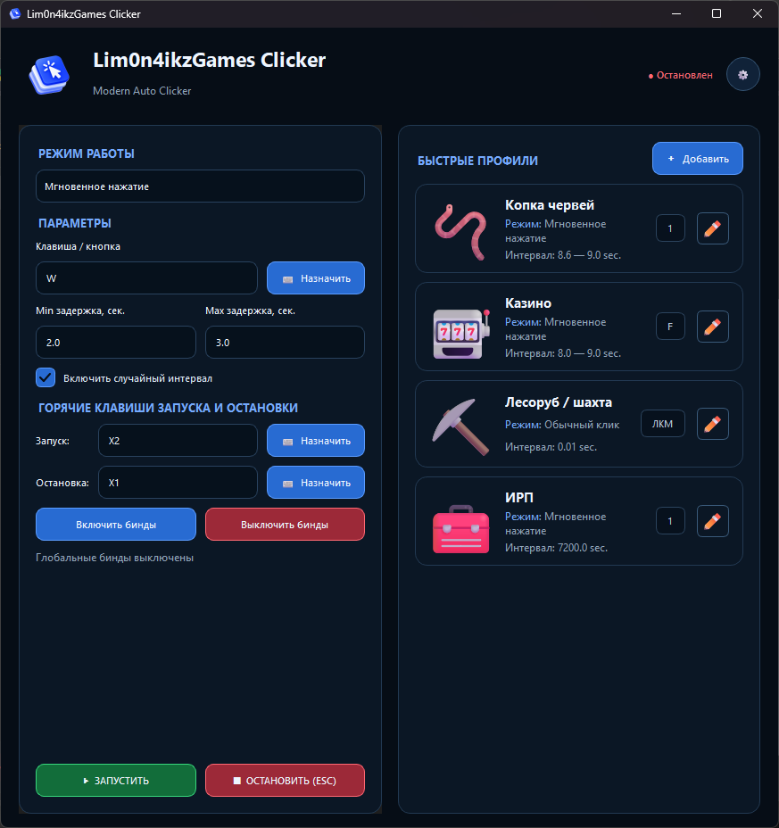

# 🍋 Lim0n4ikzGames Clicker

<p align="right"><a href="README.md">🇬🇧 English</a> · 🇷🇺 <strong>Русский</strong></p>

**Lim0n4ikzGames Clicker** — автоматический кликер для Windows с поддержкой клавиатуры, мыши, последовательностей, комбинаций, кликов по координатам и записи сценариев.

Программа позволяет автоматизировать повторяющиеся действия с помощью настраиваемых интервалов, горячих клавиш и профилей.

---

## ✨ Возможности

* 🖱️ Автоматическое нажатие кнопок мыши
* ⌨️ Автоматическое нажатие клавиш клавиатуры
* 🔗 Поддержка комбинаций клавиш
* 🔄 Поддержка последовательностей действий
* ⏱️ Настраиваемый интервал между действиями
* 🎲 Случайный интервал между нажатиями
* 🔒 Режим удержания клавиши
* ⚡ Мгновенное нажатие
* 📍 Повторяющаяся последовательность кликов по координатам
* 🎬 Запись и воспроизведение сценариев из клавиш, кликов, перемещений мыши и прокрутки
* 📊 Счётчик кликов, текущий и средний КПС за запуск; среднее фиксируется после остановки
* 🎯 Автоматическая остановка после заданного числа кликов
* ⏱️ Лимит времени работы во всех режимах
* 🎮 Горячие клавиши для запуска и остановки
* 💾 Сохранение настроек
* 📋 Сохранение пользовательских профилей
* 🌐 Поддержка русского и английского языков
* 🌙 Тёмный интерфейс
* 🖥️ Работает в фоне после запуска

---


## 🖥️ Скриншот

<p align="center">
  
</p>

---

## 🎮 Режимы работы

Программа поддерживает шесть режимов. Для любого режима можно включить остановку через заданное количество минут. В сценарном режиме дополнительно доступен лимит по числу полных выполнений; если одновременно включено несколько ограничений, сработает первое достигнутое.

### 1. 🔒 Зажатие клавиши

Клавиша удерживается в течение заданного времени.

Можно настроить:

* клавишу;
* время удержания;
* интервал между действиями;
* случайный интервал.

---

### 2. 🔄 Последовательное нажатие

Позволяет записать последовательность клавиш или кнопок мыши.

Например:

```text
1 → 2 → 3 → ЛКМ → SPACE
```

После записи программа будет повторять указанную последовательность.

Для разделения действий используется:

```text
,
```

---

### 3. ⚡ Мгновенное нажатие

Клавиша или кнопка мыши нажимается один раз без удержания.

Например:

```text
SPACE
```

или:

```text
ЛКМ
```

Можно задать минимальный и максимальный интервал между нажатиями.

---

### 4. 🔗 Мгновенная комбинация

Позволяет одновременно нажимать несколько клавиш.

Например:

```text
CTRL + C
```

или:

```text
SHIFT + SPACE
```

Для разделения клавиш комбинации используется:

```text
+
```

---

### 5. 📍 Клики по координатам

Записывает последовательность кликов и свайпов на выбранном мониторе. Нажмите на оверлей, чтобы добавить точку клика, или `F8`, чтобы захватить текущую позицию курсора. Чтобы записать свайп, зажмите `Shift` и перетащите курсор; в настройке записи выберите кнопку мыши, которая будет удерживаться во время свайпа. `Backspace` удаляет последнее действие как во время записи, так и в окне редактора после неё; `Esc` завершает запись. Клики и свайпы воспроизводятся в порядке записи и сохраняются вместе с профилем. При плавном перемещении курсор движется к следующему действию перед его выполнением и остаётся в конце свайпа до следующего действия. Плавное перемещение можно настроить на постоянную или случайную длительность; при его включении отдельный интервал между кликами не используется. Без плавного перемещения можно задать фиксированный или случайный интервал между действиями. Интервал между полными циклами настраивается отдельно.

---

### 6. 🎬 Записанный сценарий

Выберите режим **«Записанный сценарий»** в главном окне и используйте кнопки **«Записать сценарий»** и **«Редактировать сценарий»** прямо в этом режиме. Запись также доступна в редакторе профиля, если сценарий нужно хранить вместе с профилем. Нажмите горячую клавишу запуска (по умолчанию `F6`), чтобы начать захват, и горячую клавишу остановки (`F7`), чтобы завершить. Записываются нажатия и отпускания клавиш, клики и удержания кнопок мыши, движения и перетаскивания курсора, прокрутка колеса и исходные интервалы между действиями. Сценарий из главного режима сохраняется отдельно в `scenario.json`; сценарий профиля хранится в самом профиле. После выполнения сценарий повторяется с заданным фиксированным или случайным интервалом. Для сценария можно дополнительно задать лимит по числу полных выполнений; общий лимит времени работает во всех режимах.

Кнопка **«Редактировать сценарий»** открывает редактор: выберите действие, измените его тип, клавишу или кнопку, координаты и задержку; добавляйте, удаляйте и перемещайте действия. Обучение по режиму сценария доступно через **«Показать обучение»** в настройках.

> **Важно:** запись захватывает ввод во всех приложениях, включая введённый текст. Не записывайте пароли и конфиденциальные данные.

---

## ⌨️ Горячие клавиши

По умолчанию используются:

| Действие     | Клавиша |
| ------------ | ------- |
| ▶️ Запуск    | `F6`    |
| ⏹️ Остановка | `F7`    |

Горячие клавиши можно изменить в настройках программы.

Также предусмотрена возможность отключить использование глобальных горячих клавиш.

---

## 🖱️ Поддерживаемые кнопки мыши

Программа поддерживает:

* `ЛКМ` — левая кнопка мыши
* `ПКМ` — правая кнопка мыши
* `СКМ` — средняя кнопка мыши
* `X1`
* `X2`

Также можно использовать клавиши клавиатуры.

---

## ⏱️ Интервалы

Для автоматических действий можно задать:

* минимальный интервал;
* максимальный интервал;
* время удержания;
* задержку между действиями.

### 🎲 Случайный интервал

При включённом случайном интервале программа выбирает задержку между минимальным и максимальным значением.

Например:

```text
Минимум: 0.5 сек
Максимум: 1.0 сек
```

Каждое следующее действие может выполняться через разное время в пределах указанного диапазона.

---

## 📋 Профили

В программе предусмотрена система профилей.

Профиль позволяет сохранить отдельную конфигурацию кликера и быстро переключаться между различными наборами настроек.

Приложение распространяется без начальных профилей: список пуст, пока пользователь не добавит свои профили. Уже сохранённые профили сохраняются при обновлении приложения.

---

## 💾 Сохранение настроек

Настройки приложения и профили сохраняются автоматически.

В установленной версии Windows они находятся в:

```text
%LOCALAPPDATA%\Lim0n4ikzGamesClicker\
```

Основные файлы:

```text
settings.json
profiles.json
scenario.json
```

`settings.json` содержит настройки приложения.

`profiles.json` содержит сохранённые профили.

`scenario.json` хранит отдельный сценарий, созданный в главном режиме.

При закрытии программы настройки и профили автоматически сохраняются.

---

## 🌐 Язык интерфейса

Поддерживаются:

* 🇷🇺 Русский
* 🇬🇧 English

Язык можно изменить непосредственно в настройках приложения.

---

# 📦 Установка

Для обычной установки программы **не требуется Python или ручная установка зависимостей**.

Используйте готовый установщик:

```text
Lim0n4ikzGamesClickerSetup.exe
```

### Установка

1. Запустите:

```text
Lim0n4ikzGamesClickerSetup.exe
```

2. Следуйте инструкциям установщика.
3. Дождитесь окончания установки.
4. Запустите **Lim0n4ikzGames Clicker** через созданный ярлык.

После установки программа готова к работе.

---

## 🔄 Проверка обновлений

При запуске приложение проверяет файл [`versions.json`](https://github.com/lim0n4ikz/Lim0n4ikzGamesClicker/blob/main/versions.json) в основной ветке GitHub. Если доступна более новая версия, приложение покажет изменения всех версий после установленной и предложит открыть страницу загрузки установщика.

Чтобы опубликовать обновление:

1. Установите одинаковый номер релиза в `APP_VERSION` в `main.py`, `MyAppVersion` в `Lim0n4ikzGamesClicker.iss`, `latest_version` и поле `version` новой записи в `versions.json`.
2. Укажите ссылку на установщик в `versions.json`.
3. Добавьте в `releases` запись с пунктами `changes.ru` и `changes.en`, а также `telegram_post.features` и `telegram_post.fixes`. Каждый пункт `changes.ru` должен находиться ровно в одной из двух категорий Telegram-поста. Не удаляйте записи предыдущих версий: они нужны, чтобы показать полный список изменений пользователям старых версий.
4. Опубликуйте установщик на GitHub Releases по указанной в `download_url` ссылке.

---

## 📋 Импорт и экспорт профилей

Нажмите значок лупы рядом с заголовком списка профилей и введите название, чтобы найти нужный профиль. Откройте настройки через кнопку-шестерёнку и выберите «Экспортировать профили» или «Импортировать профили». При экспорте отметьте нужные профили галочкой ✔️ или выберите «Выбрать все профили», затем сохраните JSON-файл. В начальное имя экспортируемого файла автоматически добавляются дата и время в формате ДДММГГЧЧММ без разделителей, например `3110260040`. При импорте профили с уже существующими названиями тоже добавляются, но получают уникальную пометку, например `Профиль (импорт 2)`. Файл импорта должен быть в формате JSON приложения и иметь размер не более 5 МБ.

---

## 🎨 Настройки приложения

При первом запуске, а для постоянных пользователей — после обновления версии, приложение предложит пройти обучение. Кнопка **«Пройти позже»** и крестик в окне повторят предложение при следующем запуске, а **«Не показывать снова»** отключит его навсегда, в том числе после будущих обновлений. Обучение в любое время доступно в настройках через **«Показать обучение»**; там же можно выбрать один режим или **«Показать все режимы»**. Обучение объясняет управление клавишами и кнопками мыши, интервалы, лимиты и горячие клавиши; для координат — запись точек и свайпов, для сценариев — захват, редактирование, повторы и сохранение. Тур подсвечивает соответствующие элементы главного окна и не запускает действия.

В настройках также можно выбрать тёмную, бирюзовую, фиолетовую, зелёную, оранжевую, серую, синюю, красную или розовую тему. Лимит времени задаётся в параметрах главного окна и действует во всех режимах. Там же находятся ручная проверка обновлений, кнопка «Сообщить об ошибке (Bug-report)» для открытия [формы обратной связи](https://forms.gle/MZvS2rtF4Sae8eAV6), импорт и экспорт профилей, а также назначение клавиши аварийной остановки. Она активна всегда, даже при выключенных обычных биндах. Рекомендуется отдельная клавиша, например Pause/Break или F12, не используемая для запуска или часто в игре. Выбранные тема, язык и клавиша сохраняются после перезапуска. Внизу отображается информация о разработчике и его Discord.

---

# 🛠️ Сборка из исходников

Если вы хотите самостоятельно собрать программу, можно использовать PyInstaller.

## 🧪 Безопасный запуск для тестирования

Запустите `run_test.bat` из папки проекта. Он использует текущий исходный код и отдельные настройки, профили и сценарии в `%LOCALAPPDATA%\Lim0n4ikzGamesClicker-Test`. При первом запуске тестовая копия читает существующие настройки и профили проекта, но любые последующие изменения сохраняет только в тестовую папку. Основные `settings.json`, `profiles.json` и `scenario.json` не изменяются.

Этот способ проверяет приложение из исходников, но не тестирует установщик. Для установки собранного установщика безопаснее использовать отдельную учётную запись Windows.

## Требования

Для сборки необходимы:

* Windows
* Python
* PySide6
* pynput
* PyInstaller

Установить зависимости можно командой:

```cmd
pip install PySide6 pynput pyinstaller
```

## Пост для Telegram

Запустите скрипт из папки проекта. В окне выберите версию, при необходимости отредактируйте текст и нажмите **«Копировать готовый пост»** или используйте `Ctrl+Shift+C`:

```cmd
python generate_telegram_post.py
```

Для командного режима укажите версию напрямую, например `python generate_telegram_post.py --version 2.1`; пост будет сразу скопирован в буфер обмена. Параметр `--no-clipboard` выводит текст в терминал. Для каждого релиза в `versions.json` заполнены категории `telegram_post.features` и `telegram_post.fixes`; при добавлении нового релиза распределите по ним все пункты `changes.ru`.

---

## 🔨 Способы сборки

### Способ 1 — через BAT-файл

Самый простой способ — запустить:

```cmd
build_Lim0n4ikzGamesClicker.bat
```

BAT-файл автоматически выполняет необходимые команды сборки.

---

### Способ 2 — вручную через PyInstaller

Для ручной сборки используйте файл:

```text
Lim0n4ikzGamesClicker.spec
```

Команда:

```cmd
pyinstaller Lim0n4ikzGamesClicker.spec
```

После успешной сборки готовые файлы появятся в каталоге:

```text
dist\
```

---

## 🎨 Иконка приложения

Для приложения используется иконка:

```text
lim0n4ikzgames.ico
```

При самостоятельной сборке убедитесь, что файл иконки находится в проекте и учитывается конфигурацией сборки.

---

# 📁 Структура проекта

Примерная структура проекта:

```text
Lim0n4ikzGamesClicker/
│
├── lim0n4ikzgames.ico
├── Lim0n4ikzGamesClicker.spec
├── build_Lim0n4ikzGamesClicker.bat
├── Lim0n4ikzGamesClickerSetup.exe
│
├── settings.json
├── profiles.json
├── scenario.json
│
└── исходные файлы проекта
```

---

# ⚙️ Настройки по умолчанию

| Настройка                    | Значение  |
| ---------------------------- | --------- |
| ▶️ Горячая клавиша запуска   | `F6`      |
| ⏹️ Горячая клавиша остановки | `F7`      |
| ⌨️ Клавиша нажатия           | `SPACE`   |
| Минимальный интервал         | `0.5 сек` |
| Максимальный интервал        | `1.0 сек` |
| Время удержания              | `1.0 сек` |
| Задержка между действиями    | `0.2 сек` |
| 🎲 Случайный интервал        | Включён   |
| 🌐 Язык                      | Русский   |
| ⌨️ Горячие клавиши           | Включены  |

---

# ⛔ Остановка

Остановить автоматические действия можно горячей клавишей:

```text
F7
```

Если используются другие горячие клавиши, их можно изменить в настройках.

Также `Esc` используется для отмены некоторых операций ввода, например записи последовательности или захвата клавиши.

---

# 🔐 Примечание

Программа предназначена для автоматизации повторяющихся действий.

Использование автоматизации в играх и других программах может быть ограничено их правилами или условиями использования. Ответственность за использование программы несёт пользователь.

---

# 🧰 Технологии

Проект использует:

* **Python**
* **PySide6** — графический интерфейс
* **pynput** — работа с клавиатурой и мышью
* **PyInstaller** — создание исполняемого файла

---

# 🐛 Ошибки и предложения

Если вы обнаружили ошибку или хотите предложить улучшение, создайте **Issue** в репозитории проекта.

При описании ошибки желательно указать:

* версию программы;
* версию Windows;
* выбранный режим;
* используемые клавиши;
* последовательность действий, которая приводит к ошибке;
* текст ошибки, если он появился.

---

# ⭐ Поддержка проекта

Если проект оказался полезным, поставьте ⭐ **Star** репозиторию.

Это помогает проекту развиваться и показывает, что он кому-то нужен.

---

## 📄 Лицензия

Лицензия проекта не указана в исходном коде. При необходимости добавьте сюда используемую лицензию.

---

### 🍋 Lim0n4ikzGames Clicker

**Автоматизация. Простота. Удобство.**
